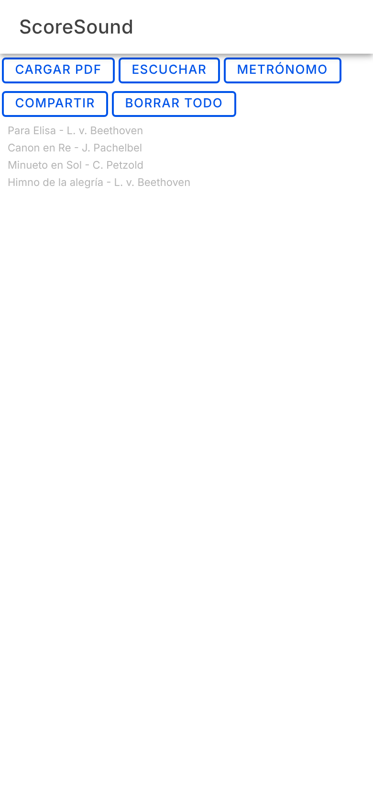
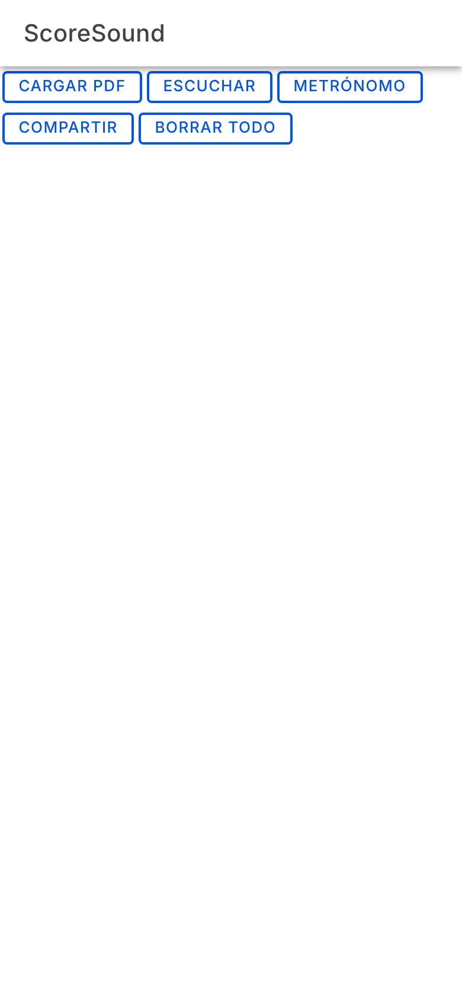
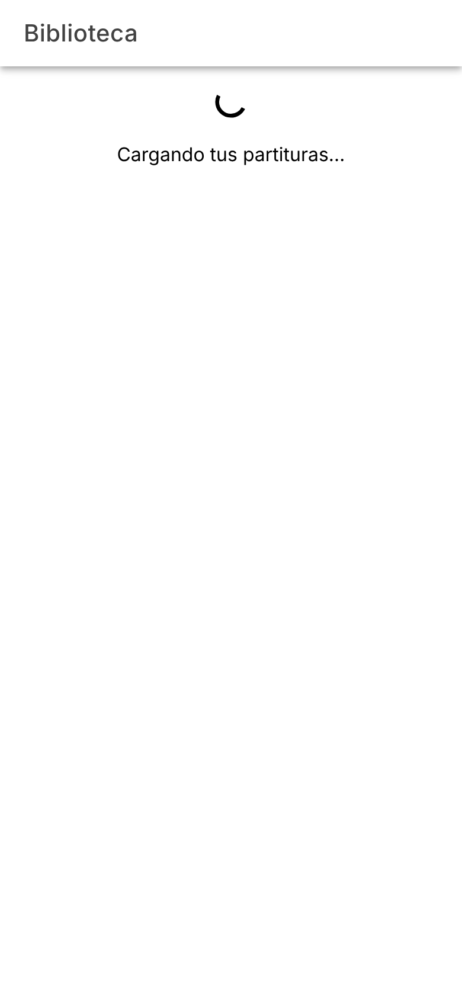
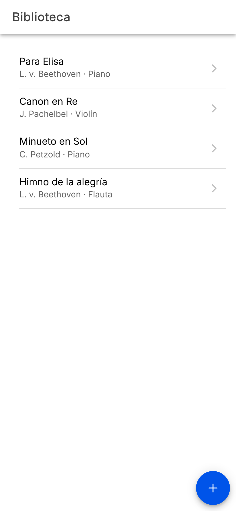
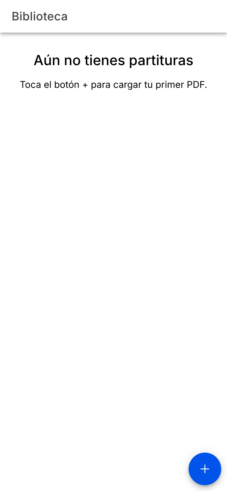
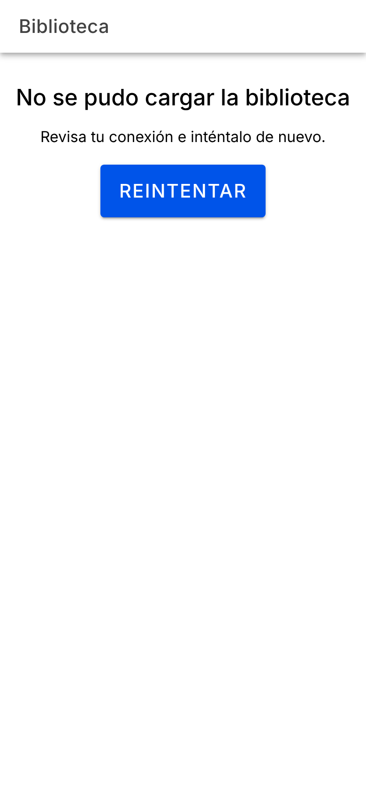
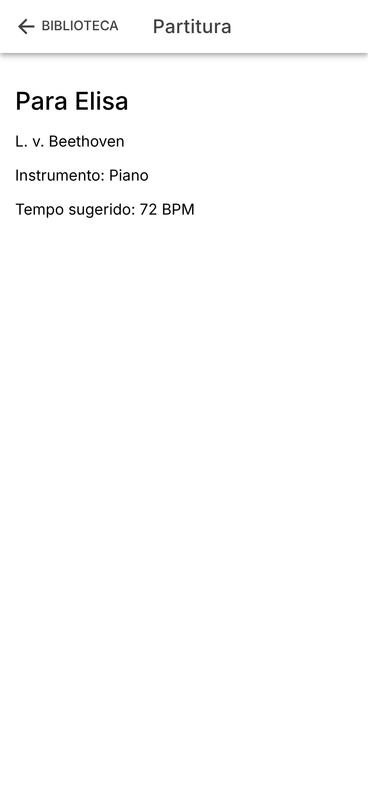

# Semana 11 · Rediseño UX de una pantalla

**Estudiante:** Juan José Horta Vanegas · Programación Móvil · 2026-B
**App:** ScoreSound (híbrida, Ionic React)
**Pantalla rediseñada:** Biblioteca de partituras

## La pantalla antes

La Biblioteca mostraba arriba cinco botones iguales (Cargar PDF, Escuchar, Metrónomo, Compartir y Borrar todo) y debajo una lista de textos grises pequeños. Código: [`antes/BibliotecaAntes.tsx`](antes/BibliotecaAntes.tsx).

| Antes · con datos | Antes · cargando | Antes · error |
| --- | --- | --- |
|  |  |  |

Problemas que encontré:

- **Sin jerarquía.** Las cinco acciones tienen el mismo tamaño y el mismo estilo, así que nada indica cuál es la principal. Además están arriba, lejos del pulgar.
- **Sin navegación.** Tocar una partitura no hace nada; no hay forma de ver su detalle.
- **Sin estados.** Mientras carga, la pantalla se queda en blanco. Si la carga falla también queda en blanco, y el error solo aparece en la consola. Si no hay partituras, igual: en blanco.
- **"Borrar todo" sin confirmación**, al mismo nivel que las demás acciones.

## La pantalla después

Código: [`despues/BibliotecaPage.tsx`](despues/BibliotecaPage.tsx), [`despues/PartituraPage.tsx`](despues/PartituraPage.tsx) y [`despues/App.tsx`](despues/App.tsx).

| Cargando | Con datos | Vacío | Error |
| --- | --- | --- | --- |
|  |  |  |  |

### Jerarquía

La pantalla tiene **una sola acción principal: cargar una partitura en PDF**, que es la primera función del MVP. Va en un botón flotante (+) abajo a la derecha, al alcance del pulgar. El resto de la pantalla es la lista, con el título de cada partitura en negro y el compositor y el instrumento debajo, en gris y más pequeño.

Escuchar y Metrónomo salieron de esta pantalla porque se hacen sobre una partitura concreta, no sobre la Biblioteca. Borrar todo también salió.

El botón + marca el lugar de la acción, pero todavía no abre el selector de archivos. Cargar el PDF es otra funcionalidad del MVP y no hace parte de esta actividad.

### Navegación: stack

Usé el patrón **stack**, que es el que corresponde a un flujo lista → detalle. Al tocar una partitura se abre su detalle en `/biblioteca/:id`, y el botón atrás vuelve a la Biblioteca. Las rutas están en `App.tsx` y el botón atrás es un `IonBackButton`.

| Detalle de una partitura |
| --- |
|  |

### Los tres estados

| Estado | Qué ve el usuario |
| --- | --- |
| Cargando | Un spinner y el texto "Cargando tus partituras…" |
| Con datos | La lista de partituras y el botón + |
| Error | "No se pudo cargar la biblioteca", una sugerencia y el botón **Reintentar**. Aquí Reintentar es la acción principal, así que el + no aparece |
| Vacío | "Aún no tienes partituras" y una indicación de usar el botón + |

El detalle maneja los mismos estados, y además el caso de una partitura que no existe ("Esta partitura no existe").

**Cómo ver cada estado:** ScoreSound todavía no tiene backend, así que la carga se simula en [`partituras.ts`](partituras.ts) con una espera de 1,2 segundos. Para ver el vacío o el error, cambia la constante `MODO` por `'vacio'` o `'error'`.

## Accesibilidad: antes y después

Medí los valores en el navegador, con la pantalla a 390 × 844 px (tamaño de un teléfono).

| Qué revisé | Antes | Después |
| --- | --- | --- |
| Contraste del texto de la lista (sobre blanco) | Gris #B5B5B5: **2,05 : 1** | Título negro: **21 : 1** · Subtítulo #666666: **5,74 : 1** |
| Tamaño del texto de la lista | 11 px | Título 16 px · Subtítulo 14 px |
| Alto de los botones | 27 px (los cinco) | Botón + 56 × 56 px · Reintentar 56 px |
| Alto de cada fila de la lista | 18 px, y no se podía tocar | 66 px, toda la fila es tocable |
| Botón atrás del detalle | (no existía) | 44 px de alto |
| Botón con solo un ícono | (no había) | El + tiene la etiqueta "Cargar partitura en PDF" para lectores de pantalla |
| Avisos de estado | Ninguno | El texto de carga tiene `role="status"` y el de error `role="alert"` |

El contraste de 2,05 : 1 del antes no alcanza el mínimo de 4,5 : 1 que se suele pedir para texto normal. Los 27 px de los botones quedan por debajo de los 44 px de área táctil que pide la sesión. En el después todo el texto supera 4,5 : 1 y todos los controles tocables miden 44 px o más.

## Archivos

```text
11-week/
├── README.md
├── partituras.ts            datos y carga simulada (compartido)
├── antes/
│   └── BibliotecaAntes.tsx  la pantalla antes del rediseño
├── despues/
│   ├── App.tsx              rutas del stack
│   ├── BibliotecaPage.tsx   Biblioteca rediseñada
│   └── PartituraPage.tsx    detalle de una partitura
└── capturas/                imágenes del antes y el después
```
