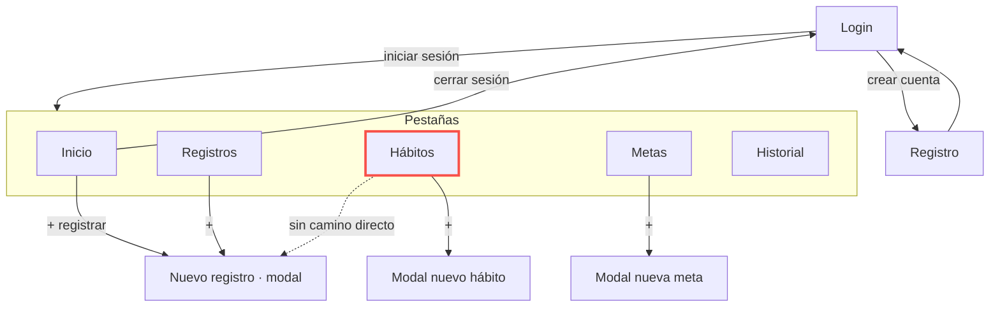

# 01 · Auditoría UX de mis pantallas

**Pantallas:** Hábitos (`HabitosScreen`) y Metas (`MetasScreen`) de Healthy Habits Tracker.
Capturas del estado actual: `img/before-habitos.png` y `img/before-metas.png`.

## Hallazgos

| # | Pantalla | Problema | Principio | Severidad | Arreglo propuesto |
| --- | --- | --- | --- | --- | --- |
| 1 | Hábitos | La lista no tiene estado de carga: hoy los hábitos salen de memoria al instante, y cuando se conecte el backend la pantalla quedará en blanco mientras responde | Estados de la interfaz | Alta | Filas esqueleto con la forma de la tarjeta de hábito |
| 2 | Hábitos | No existe estado de error: si la carga falla, el usuario no ve ningún mensaje ni puede volver a intentar | Retroalimentación | Alta | Mensaje claro y botón Reintentar |
| 3 | Hábitos | Las etiquetas Unidad, Meta, Racha y Registros usan el color `subtle` (#484F58) sobre la tarjeta (#161B22): contraste de 2,09:1, por debajo de 4,5:1 | Contraste | Alta | Subir el token `subtle` a un gris con contraste de 4,5:1 o más |
| 4 | Hábitos | Esas mismas etiquetas miden 10 px (`fontSize.xs - 1`) | Textos legibles | Media | Usar como mínimo `fontSize.xs` (11 px) |
| 5 | Hábitos | El botón "+" para crear un hábito mide 40 × 40 px, por debajo de los 44 px | Área táctil mínima | Media | Llevarlo a 48 × 48 px |
| 6 | Hábitos | El botón "+" solo muestra un símbolo y no tiene `accessibilityLabel`; el lector de pantalla no dice qué hace | Etiquetas para lectores de pantalla | Media | `accessibilityLabel="Crear hábito"` |
| 7 | Hábitos | Cada tarjeta tiene un botón "Eliminar" rojo de ancho completo, más llamativo que el dato del hábito y que la acción principal de la pantalla (crear) | Jerarquía visual | Media | Dejar Eliminar como acción secundaria discreta y destacar "+" |
| 8 | Hábitos | Desde un hábito no se puede registrar el avance del día: "Nuevo registro" solo se abre desde Inicio y Registros | Patrón de navegación | Media | Acceso a Nuevo registro desde la tarjeta del hábito |
| 9 | Hábitos | En el formulario "Nuevo hábito" el error es un único mensaje arriba ("Nombre, categoria y unidad de medida son obligatorios") y no se marca el campo que falta | Retroalimentación | Media | Mensaje debajo de cada campo con error |
| 10 | Metas | El botón "+" para crear una meta mide 40 × 40 px y no tiene `accessibilityLabel` | Área táctil y etiquetas | Media | 48 × 48 px y `accessibilityLabel="Crear meta"` |
| 11 | Metas | Tampoco tiene estados de carga ni de error | Estados de la interfaz | Media | Mismo patrón de estados que Hábitos |

## Mapa de navegación actual

**Dónde se pierde el usuario:** en Hábitos ve la racha de cada hábito, pero para registrar el avance de ese hábito tiene que salir a Inicio o a Registros y volver a elegirlo en el formulario (línea punteada).
