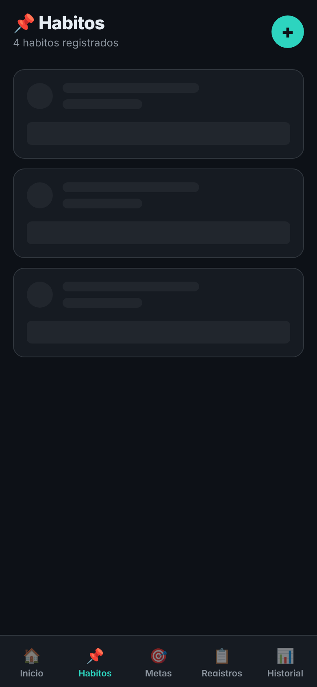
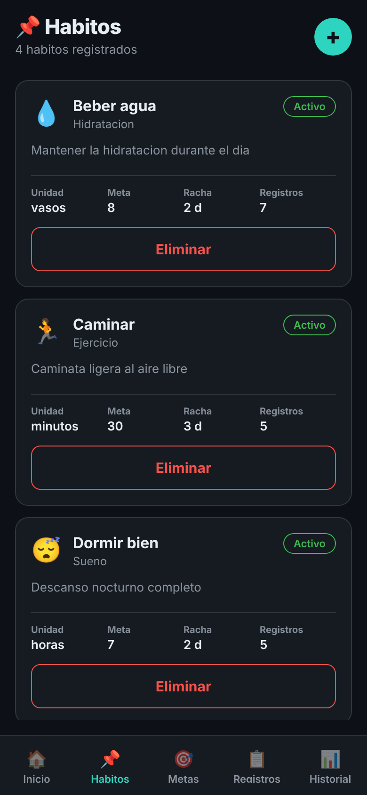
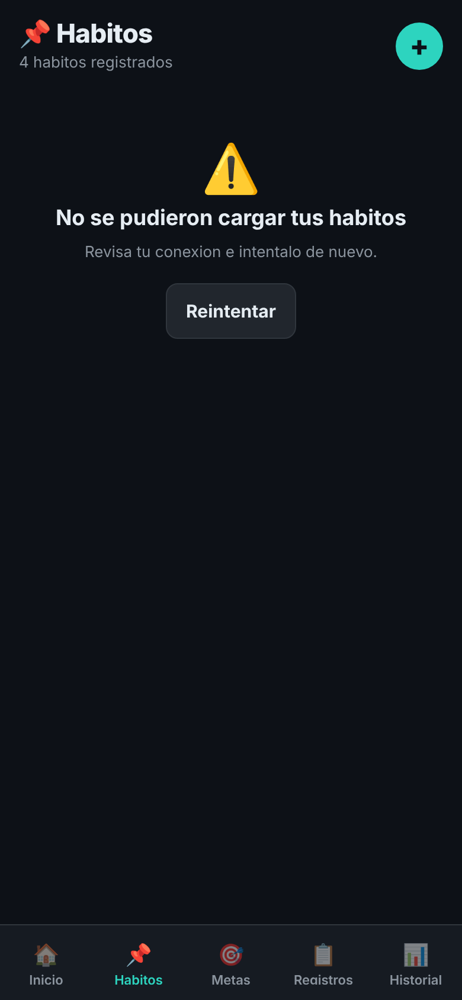
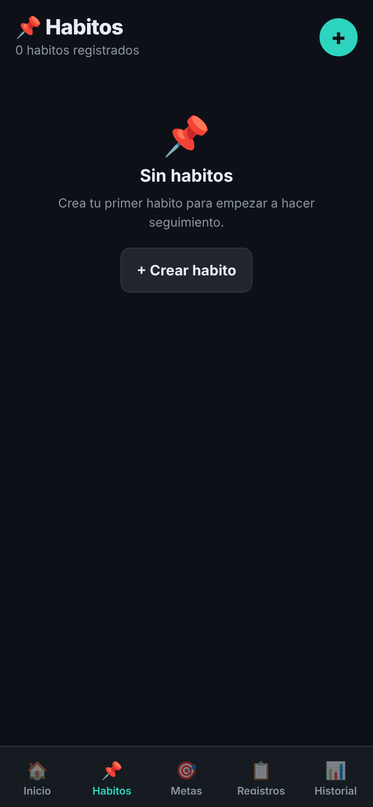

# 03 · Pantalla Hábitos con sus tres estados

La lista de Hábitos (`app/src/screens/HabitosScreen.tsx`) ahora pasa por tres estados antes de mostrar los hábitos del usuario.

| Estado | Qué ve el usuario | Captura |
| --- | --- | --- |
| Cargando | Tres tarjetas grises con la forma de la tarjeta de hábito: ícono de categoría, nombre, categoría y la fila de datos (`SkeletonHabitos`) |  |
| Con datos | La lista de hábitos con su categoría, meta, racha y registros |  |
| Error | "No se pudieron cargar tus habitos" y el botón **Reintentar** |  |
| Vacío | "Sin habitos" y el botón **+ Crear habito** |  |

Además, la lista se puede recargar deslizando hacia abajo (`RefreshControl`, el equivalente en React Native de `IonRefresher`).

## Cómo forzar cada estado

El backend NestJS todavía no está conectado, así que `app/src/services/simulacion.ts` simula la espera y la falla de la petición con variables de entorno de Expo:

| Estado | Cómo verlo |
| --- | --- |
| Cargando | Se ve al abrir la pestaña Hábitos (800 ms por defecto). Para verlo más tiempo: `EXPO_PUBLIC_RETRASO_MS=4000 npm start` |
| Error | `EXPO_PUBLIC_SIMULAR_FALLA=1 npm start` |
| Vacío | Dejar vacío el arreglo `habitos` de `app/src/constants/mockData.ts` mientras se toma la captura (los hábitos con registros no se pueden eliminar desde la app) |
| Con datos | `npm start` normal |

## Prueba automatizada

`app/src/screens/__tests__/HabitosScreen.test.tsx`, con Jest y React Native Testing Library (el equivalente de Vitest con Testing Library para React Native):

- comprueba que aparece el mensaje de error cuando la carga falla;
- comprueba que **Reintentar** vuelve a pedir los hábitos (`simularPeticion` se llama dos veces) y que aparece la lista.

```bash
cd app
npm test
```
