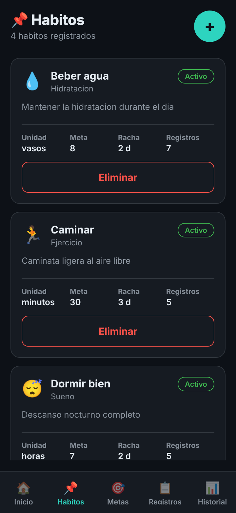
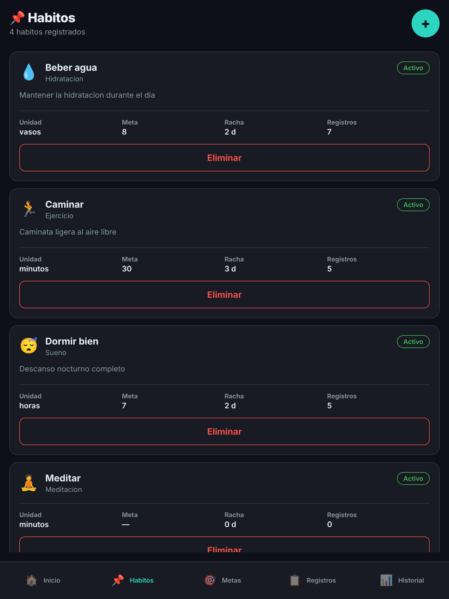
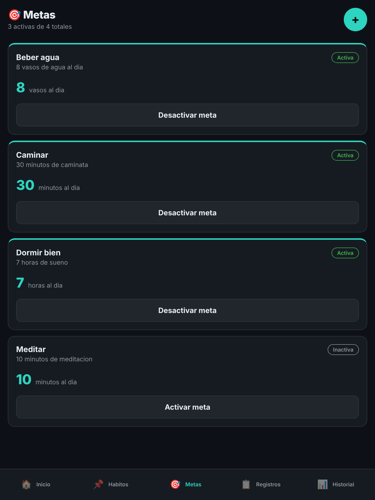

# 04 · Accesibilidad y diseño responsivo

## Lo que corregí en Hábitos y Metas

| Problema | Pantalla | Corrección |
| --- | --- | --- |
| El botón "+" solo tenía un símbolo y el lector de pantalla no decía qué hacía | Hábitos, Metas | `accessibilityRole="button"` y `accessibilityLabel` "Crear habito" / "Crear meta" |
| El botón "+" medía 40 × 40 px | Hábitos, Metas | 48 × 48 px |
| Las etiquetas Unidad, Meta, Racha y Registros medían 10 px | Hábitos | 11 px (`fontSize.xs`); el color ya se había corregido en el CP2 |
| El emoji de la categoría se leía como imagen sin sentido ("gota", "corredor") al lado del nombre de la categoría | Hábitos | Se oculta al lector de pantalla; el nombre de la categoría ya lo dice |

En React Native los textos crecen con el tamaño de letra del sistema (`allowFontScaling` viene activado), así que no hubo tamaños fijos que bloquearan ese crecimiento. El estado Activo / Inactivo de cada hábito y de cada meta ya tenía texto, no solo color.

## Lighthouse (categoría Accesibilidad)

Medido con la app abierta en el navegador (`npm run web`), en modo **Instantánea** de Lighthouse sobre cada pestaña, porque en modo Navegación Lighthouse solo ve la pantalla de Login.

| Pantalla | Antes | Después |
| --- | --- | --- |
| Hábitos | 100 | 100 |
| Metas | 100 | 100 |

El puntaje no cambió. Lighthouse no revisa el tamaño mínimo de 44 px, y en la web el "+" antiguo no se exponía como botón (no tenía rol), así que Lighthouse tampoco podía reclamar que le faltara nombre. Por eso estas correcciones salieron de la auditoría del CP1 y no del puntaje.

## Pantalla pequeña y tableta

| Ancho | Hábitos | Metas |
| --- | --- | --- |
| 360 px |  |  |
| 768 px |  |  |

Lo que observé al probar los dos anchos en el modo dispositivo del navegador:

- **360 px:** las tarjetas de Hábitos y de Metas caben completas; las cuatro columnas Unidad, Meta, Racha y Registros se leen sin cortarse y la barra de pestañas muestra las cinco etiquetas.
- **768 px:** no se rompe nada; las tarjetas se estiran a todo el ancho, así que queda mucho espacio libre entre el nombre del hábito y la etiqueta Activo. No lo cambié porque no impide usar la pantalla.
