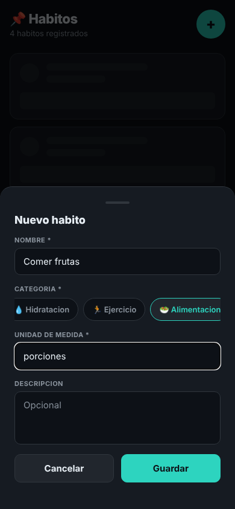
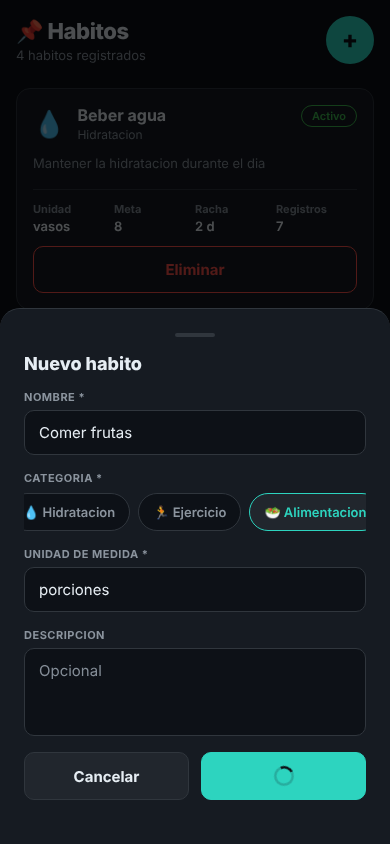
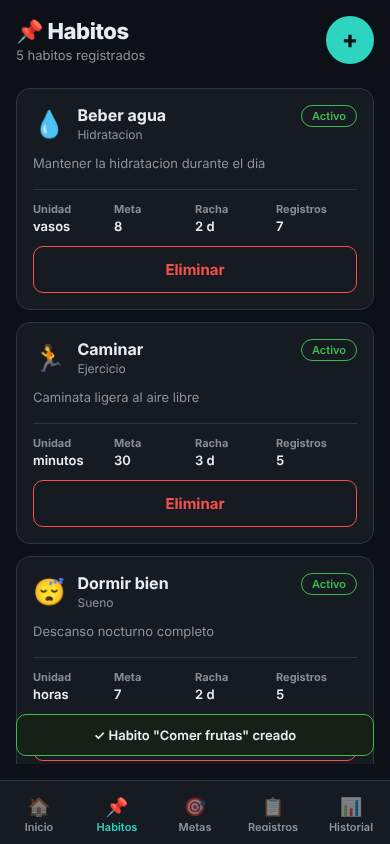
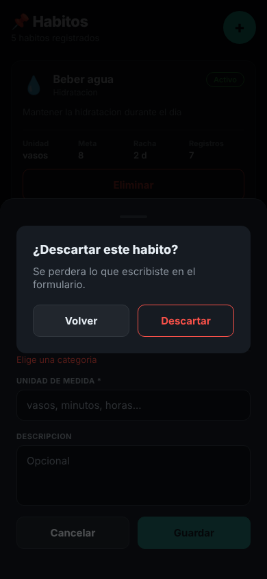
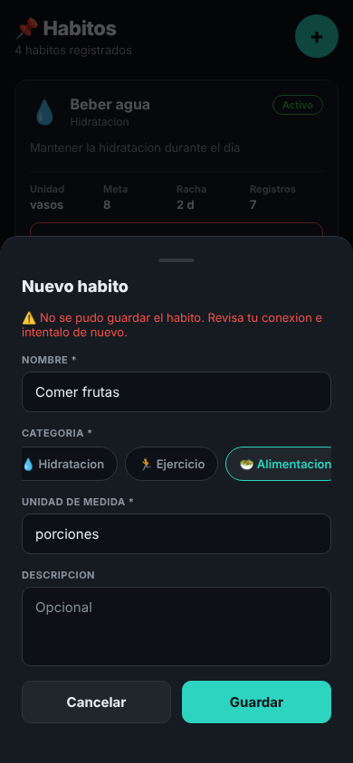

# 06 · Formulario "Nuevo habito" con validación y retroalimentación

Elegí el formulario de creación de **Habito**, la entidad principal de la app: sin hábitos no hay metas, registros diarios ni historial. Se abre con el botón "+" de la pestaña Hábitos (`app/src/screens/HabitosScreen.tsx`).

## Reglas de cada campo

Las reglas están en `app/src/utils/validarHabito.ts` y salen del modelo `Habito` de `app/src/types/index.ts`, que copia el `schema.prisma` del backend del equipo.

| Campo | Regla | Mensaje debajo del campo | Por qué existe |
| --- | --- | --- | --- |
| Nombre | Obligatorio; solo espacios no cuenta | "Escribe el nombre del habito" | `nombre` no es opcional en `Habito`. Es lo que el usuario ve en Hábitos, Metas, Registros e Historial; un hábito sin nombre no se puede reconocer en ninguna lista |
| Categoría | Hay que elegir una | "Elige una categoria" | `categoriaHabitoId` es obligatorio: cada hábito pertenece a una `CategoriaHabito` (Hidratación, Ejercicio…), y de ahí sale el ícono de la tarjeta |
| Unidad de medida | Obligatoria; solo espacios no cuenta | "Indica como lo mides: vasos, minutos, horas..." | `unidadMedida` es obligatoria porque `RegistroDiario.valorRegistrado` y `Meta.valorObjetivo` son números que no significan nada sin unidad ("8" ¿vasos u horas?) |
| Descripción | Opcional, sin regla | — | En el modelo es `descripcion?` |

El mensaje aparece cuando el usuario ya tocó el campo, no al abrir el formulario vacío. El de categoría aparece en cuanto se escribe en otro campo sin haber elegido una.

## Cómo responde el formulario

- **Guardar deshabilitado** mientras haya cualquier error.
- **Enviando:** el botón Guardar muestra un indicador de carga y no acepta un segundo toque, así no se crean dos hábitos iguales por doble clic.
- **Éxito:** se cierra la hoja y aparece un toast con "Habito "…" creado" (componente `Toast`, equivalente a `IonToast`).
- **Falla del servidor:** el formulario no se cierra ni pierde lo escrito, y arriba aparece "No se pudo guardar el habito. Revisa tu conexion e intentalo de nuevo.".
- **Cancelar con datos escritos:** antes de borrar lo escrito pregunta "¿Descartar este habito?" (componente `DialogoConfirmacion`, equivalente a `IonAlert`). Si el formulario está vacío, se cierra sin preguntar.

La app es React Native y no Ionic, así que `IonToast` e `IonAlert` se reemplazan por esos dos componentes propios. No usé `Alert.alert` de React Native porque en el navegador (`npm run web`) no muestra nada.

## Cómo forzar cada estado

El backend todavía no está conectado; `simularPeticion` (`app/src/services/simulacion.ts`) simula la espera y la falla del guardado.

| Estado | Cómo verlo |
| --- | --- |
| Errores por campo | Escribir en Nombre y Unidad y borrar el texto, sin elegir categoría |
| Enviando | `EXPO_PUBLIC_RETRASO_MS=3000 npm run web` y tocar Guardar |
| Falla del servidor | `EXPO_PUBLIC_FALLA_GUARDADO=1 npm run web` |
| Éxito y descartar | `npm run web` normal |

## Capturas

| Errores | Válido | Enviando |
| --- | --- | --- |
|  |  |  |

| Éxito (toast) | Confirmar descarte | Falla del servidor |
| --- | --- | --- |
|  |  |  |
