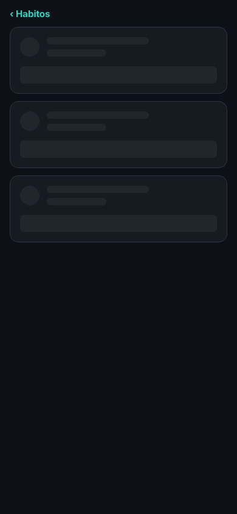
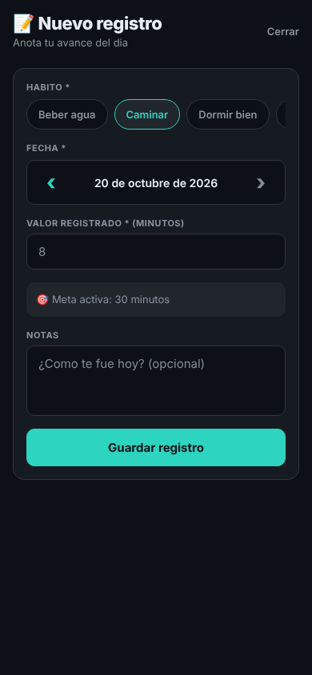
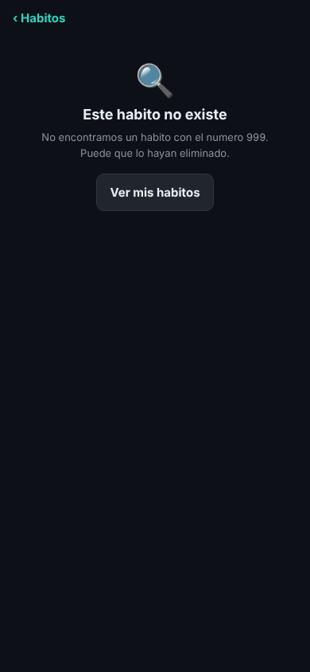
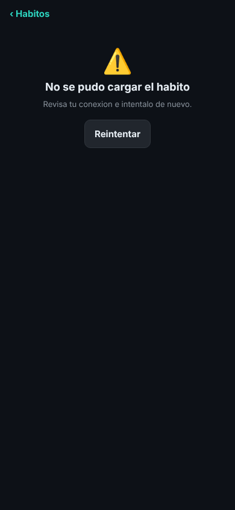
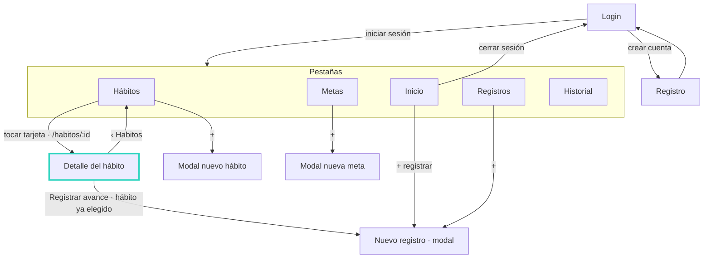

# 07 · Detalle del hábito y flujo de navegación completo

## Pantalla de detalle

`app/src/screens/HabitoDetalleScreen.tsx` se abre al tocar cualquier tarjeta de la lista de Hábitos. Recibe el `id` del hábito por la ruta: es un parámetro de la pila (`HabitoDetalle: { id: number }` en `types/index.ts`) y, en el navegador, la URL `/habitos/:id` (configurada con `linking` en `AppNavigator.tsx`). Por ejemplo, Caminar abre `/habitos/2`.

Muestra la categoría, la frecuencia, la meta activa, la racha actual y máxima, y los cinco últimos `RegistroDiario` del hábito. El botón **Registrar avance** abre Nuevo registro con ese hábito ya elegido.

| Estado | Qué se ve | Cómo forzarlo |
| --- | --- | --- |
| Cargando | Tarjetas esqueleto (`SkeletonHabitos`) | Aparece al abrir; `EXPO_PUBLIC_RETRASO_MS=3000` para verlo más |
| Con datos | Detalle del hábito y sus últimos registros | `npm run web` y tocar un hábito |
| Error | "No se pudo cargar el habito" y Reintentar | `EXPO_PUBLIC_FALLA_DETALLE=1 npm run web` |
| No encontrado | "Este habito no existe" y Ver mis habitos | Abrir `http://localhost:8081/habitos/999` |

**‹ Habitos** (44 px de alto, con etiqueta para lector de pantalla) vuelve a la lista. Si el detalle se abrió directo por URL y no hay pantalla anterior, lleva a las pestañas.

Se mantiene el patrón del CP2: pestañas para las secciones y pila para entrar a un detalle.

| Cargando | Con datos | Registrar avance |
| --- | --- | --- |
|  |  |  |

| No encontrado | Error |
| --- | --- |
|  |  |

## Mapa de navegación nuevo

## Comparación con el mapa del CP1

En el CP1 la línea punteada mostraba el problema: desde Hábitos no había camino hacia el registro de ese hábito.

| Tarea | Antes (CP1) | Ahora |
| --- | --- | --- |
| Registrar el avance de "Caminar" estando en Hábitos | Cambiar a la pestaña Registros → tocar "+" → buscar Caminar entre los chips → escribir el valor → Guardar (5 pasos) | Tocar Caminar → Registrar avance → escribir el valor → Guardar (4 pasos, sin cambiar de pestaña ni volver a buscar el hábito) |
| Ver los últimos días de un hábito | Ir a la pestaña Registros → elegir el hábito en el filtro (2 pasos, y sin racha ni meta a la vista) | Tocar el hábito (1 paso) |
| Ver la racha máxima de un hábito | No se mostraba en ninguna pantalla | Aparece en el detalle |
