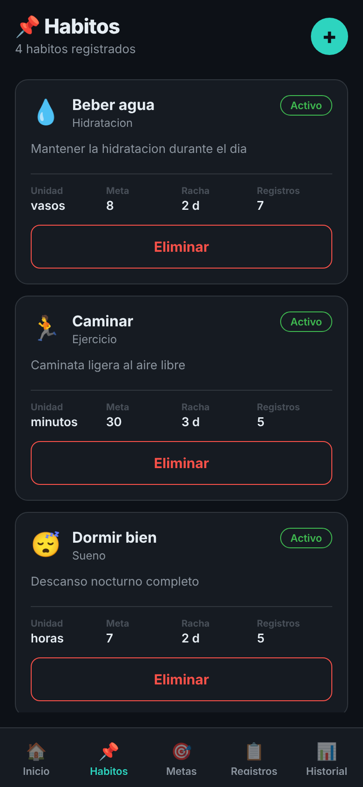
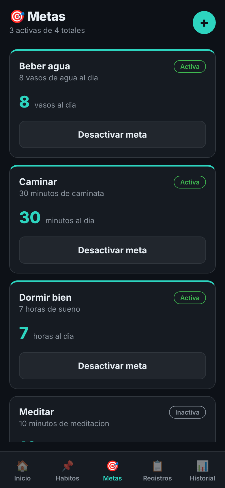
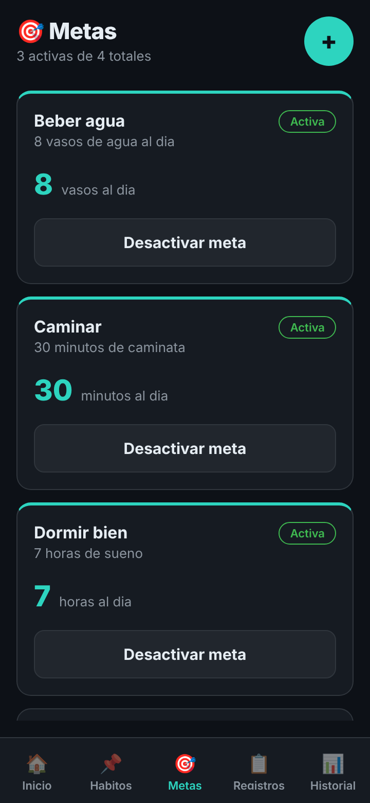
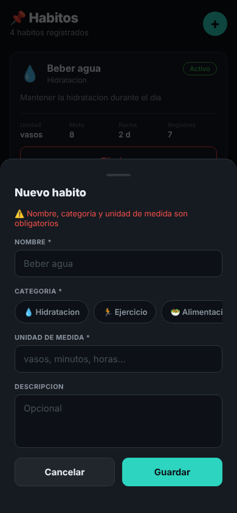
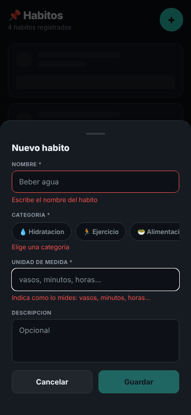
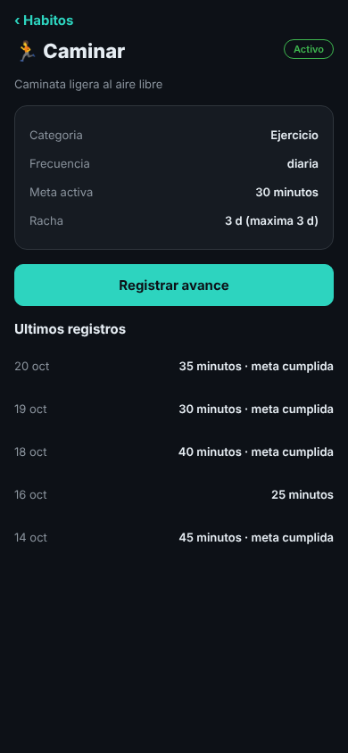
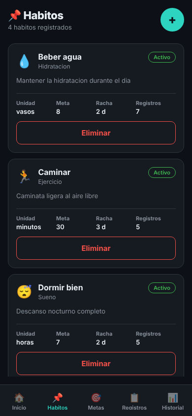
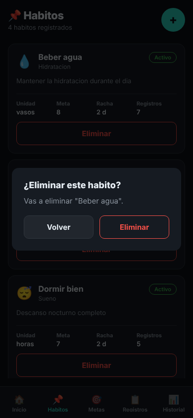

# 09 · Antes y después, e historias para el equipo

Las capturas "antes" son de la app del equipo tal como estaba en la línea base; las "después" son de mi fork. Todas están en `img/`.

## Antes y después de cada pantalla

### Hábitos (la lista)

| Antes | Después |
| --- | --- |
|  |  |

Las etiquetas Unidad, Meta, Racha y Registros pasaron de un gris casi invisible (contraste 2,09:1) a uno legible (5,14:1), y subieron de 10 a 11 px. El botón "+" ahora mide 48 px y tiene nombre para el lector de pantalla. Principios: contraste, textos legibles y área táctil mínima. Además la lista ahora tiene estados de carga, error y vacío (`03-states.md`).

### Metas

| Antes | Después (360 px) |
| --- | --- |
|  |  |

El cambio que se ve es el botón "+", que pasó de 40 a 48 px; el otro, la etiqueta "Crear meta" para el lector de pantalla, no se nota en la captura. La captura de después es de 360 px de ancho, por eso se ve más angosta. Principios: área táctil mínima y etiquetas para lectores de pantalla.

### Formulario Nuevo hábito

| Antes | Después |
| --- | --- |
|  |  |

Antes salía un solo mensaje arriba ("Nombre, categoria y unidad de medida son obligatorios") y no decía cuál campo faltaba. Ahora cada campo con problema se marca y explica su error justo debajo, y el formulario también avisa cuando se guarda (`img/after-form-habito-exito.png`) o cuando se intenta cerrar con datos escritos (`img/after-form-habito-descartar.png`). Principio: retroalimentación en los formularios.

### Detalle del hábito

| Antes | Después |
| --- | --- |
|  |  |

Esta pantalla es nueva, así que no tiene captura de antes propia: en su lugar muestro la lista, cuyas tarjetas no se podían tocar. Ahora al tocar un hábito se abre su detalle (categoría, meta, racha y últimos registros) con una ruta propia (`/habitos/:id`) y un botón para registrar el avance. Principio: patrón de navegación (pestañas para las secciones, pila para entrar a un detalle).

### Eliminar un hábito

| Antes | Después |
| --- | --- |
|  |  |

Antes, al tocar Eliminar en el navegador no pasaba nada, y no se sabía si se había borrado o no. Ahora pregunta primero y después avisa si se borró (`img/after-eliminar-exito.png`) o por qué no se pudo (`img/after-eliminar-no-permitido.png`). Salió de la prueba de usabilidad del CP8. Principios: retroalimentación y confirmar antes de una acción destructiva.

## Historias de usuario para el backlog del equipo

Estas son las tres mejoras que más valdría la pena llevar al repositorio de código del equipo.

### Historia 1 · Formulario de hábito que dice qué falta

Como persona que está creando un hábito, quiero que la app me marque qué campo falta y por qué, para corregirlo sin tener que adivinar.

Criterios de aceptación:

- Si toco Guardar con el nombre, la categoría o la unidad vacíos, aparece un mensaje debajo de cada campo que falta, y los tres mensajes salen distintos entre sí.
- El botón Guardar queda deshabilitado mientras haya algún campo obligatorio sin llenar.
- Si el guardado funciona, el formulario se cierra y aparece el aviso `Hábito "X" creado` durante unos segundos.
- Si escribí algo y toco Cancelar, aparece una pregunta para confirmar que quiero descartar el formulario; Volver me deja en el formulario con lo que escribí.
- Si falla el guardado, el formulario sigue abierto con mis datos y muestra un mensaje de error.

### Historia 2 · Confirmar antes de eliminar y saber qué pasó

Como persona que quiere borrar un hábito o un registro, quiero que la app me pregunte antes y me diga el resultado, para no borrar algo por error ni quedarme sin saber si se borró.

Criterios de aceptación:

- Al tocar Eliminar en un hábito aparece una pregunta con el nombre del hábito; Volver cierra la pregunta y la lista queda igual.
- Si confirmo y el hábito no tiene registros, desaparece de la lista y sale un aviso verde.
- Si confirmo y el hábito tiene registros, sigue en la lista y sale un aviso rojo que explica que no se puede eliminar por tener registros.
- Lo mismo se cumple con la ✕ de la pantalla Registros, que hoy sigue sin responder.
- Funciona igual en el navegador (`npm run web`) y en el celular.

### Historia 3 · Detalle de un hábito con su propia dirección

Como persona que quiere ver cómo va un hábito, quiero abrirlo y ver su detalle completo, para saber mi racha y mis últimos registros sin buscar en varias pantallas.

Criterios de aceptación:

- Al tocar la tarjeta de un hábito se abre su detalle, y en el navegador la dirección es `/habitos/<id>` (por ejemplo, Caminar abre `/habitos/2`).
- El detalle muestra la categoría, la meta activa, la racha actual y máxima, y los cinco últimos registros del hábito.
- El botón Registrar avance abre Nuevo registro con ese hábito ya elegido.
- Si abro `/habitos/999`, que no existe, veo "Este habito no existe" y un botón para volver a mis hábitos.
- Mientras carga se ven tarjetas esqueleto, y si la carga falla aparece un mensaje con el botón Reintentar.
- El botón ‹ Hábitos vuelve a la lista.
